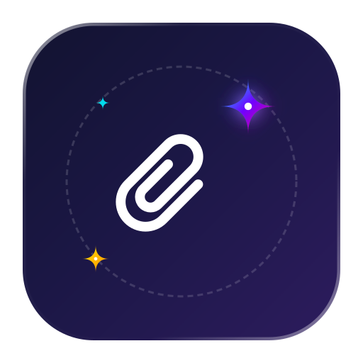

<div align="center">
  
  <h1>✨ ClipGenAI</h1>
  <p><strong>AI LLM Floating Clipboard HUD for macOS</strong></p>
  <p align="center">
    Made for  <strong>macOS</strong>
  </p>

  <p>
    
    
    
    
    
  </p>

  <p><em>Zero-click intelligence for everything you copy. Translucent floating HUD bubble, instant streaming from Gemini 2.5 Flash, 6 persona modes, and 100% native Swift.</em></p>
</div>

---

**ClipGenAI** is a native macOS utility that supercharges your clipboard with Google Gemini. Copy any code snippet, error log, article text, or foreign language phrase, and a sleek glassmorphic HUD smoothly animates into view streaming AI insights in real time. 

No tab switching, no copy-pasting into chat apps, and zero Electron bloat.

---

## 🔒 Why ClipGenAI?

| Feature | 🫧 ClipGenAI | 🌐 Web Browser LLMs | 📋 Standard Clipboard Managers |
| :--- | :--- | :--- | :--- |
| **Workflow** | ⚡ **Zero-click HUD / instant hotkey** | 🐢 Manual tab switch & paste | 📄 Plain text history only |
| **Intelligence** | 🧠 **Google Gemini 2.5 Flash streaming** | 🧠 High-latency web interface | ❌ No AI synthesis |
| **Footprint** | 🪶 **100% Native Swift (< 15MB RAM)** | 🐘 Heavy browser memory overhead | ⚠️ Variable |
| **API Security** | 🔐 **macOS Keychain (`com.aoh.clipgenai`)** | 🍪 Web cookies & trackers | ⚠️ Plaintext local storage |
| **Privacy** | 🛡️ **Ignores password manager clips** | ☁️ Tracked cloud sessions | ⚠️ Often records passwords |
| **Installation** | 🚀 **1-command build & install** | 🌐 Web login required | 💰 Paid subscription tiers |

---

## 🌟 Key Features

* 🪄 **Zero-Click Intelligence**: Automatically monitors copied text (code, questions, articles, snippets) and streams smart answers from Gemini. Can also be triggered on-demand via `⌘ + ⇧ + G`.
* 🫧 **Translucent Glassmorphic HUD**: Floating HUD bubble anchored smoothly at the bottom-right or top-right of your screen. Features auto-dismiss timers that pause when you hover your cursor.
* ⚡️ **Powered by Gemini 2.5 Flash**: Ultra-low latency streaming with exceptional reasoning capabilities powered by your personal Google AI Studio token.
* 📋 **1-Click Copyback**: Tap the copy button to place Gemini's response directly back into your clipboard.
* 📌 **Pin or Auto-Dismiss**: Responses fade away cleanly after a customizable duration, or can be pinned to remain on-screen while you reference them.
* 🎭 **6 Built-In Personas**:
  * ✨ **Smart Assistant** — Direct, high-signal answers and executive insights.
  * 📝 **Quick Summary** — 2–4 bullet executive summaries of long articles.
  * 💡 **Explain Simply** — Plain English explanations of complex topics.
  * 💻 **Code & Debug** — Bug fixes, syntax corrections, and clean code solutions.
  * ✍️ **Fix & Polish** — Grammar correction and professional writing polish.
  * 🌐 **Translate** — Instant English translation of foreign text.
* 🔒 **Keychain Security & Privacy Guard**:
  * Your Gemini API key is stored securely in your macOS Keychain (`com.aoh.clipgenai`).
  * Sensitive password manager clips (`org.nspasteboard.ConcealedType` from 1Password, Bitwarden, Apple Passwords) are automatically ignored.
* 🪶 **100% Native & Blazing Fast**: Crafted entirely in Swift, AppKit, and SwiftUI. Zero Electron bloat, minimal memory footprint, and fluid 120Hz ProMotion animations.
* 🔄 **Built-In In-App Update Checker**: Automatically alerts you when a new release is available on GitHub and updates with a single click.

---

## 📦 Installation

The fastest way to install ClipGenAI is to run this single command in **Terminal**:

```bash
/bin/bash -c "$(curl -fsSL https://raw.githubusercontent.com/arunofhyd/ClipGenAI/main/install-clipgenai.command)"
```

> **Why this works seamlessly:** The installer builds the Swift app locally on your Mac. Because it compiles directly on your machine rather than downloading an untrusted third-party binary, macOS Gatekeeper trusts it natively with zero security friction.

### Manual Installation (Local Build)

1. Clone or download the repository:
   ```bash
   git clone https://github.com/arunofhyd/ClipGenAI.git
   cd ClipGenAI
   ```
2. Run the build and install script:
   ```bash
   ./build_app.sh --install
   ```

---

## 🚀 Getting Started

1. **Get a Gemini API Key**:
   ClipGenAI uses your personal Gemini token. You can obtain a free API key in seconds from Google:
   👉 [Google AI Studio](https://aistudio.google.com/app/apikey)

2. **Launch ClipGenAI**:
   ```bash
   open "/Applications/ClipGenAI.app"
   ```
   A sparkle icon (`✨`) will appear in your macOS menu bar. On first launch, the **Settings** window will prompt you for your API key. You can test your connection right there.

3. **Copy Anything!**
   Highlight and copy text in any app (browser, terminal, notes, Slack). The floating bubble will immediately appear streaming Gemini's response!

---

## ⌨️ Shortcuts & Controls

| Action | Shortcut / Access |
|---|---|
| **Process Current Clipboard** | `⌘ + ⇧ + G` |
| **Settings & API Key** | `⌘ + ,` (or Menu Bar ✨ > Settings…) |
| **Toggle Auto-Ask on Copy** | Menu Bar ✨ > Auto-Ask on Copy |
| **Switch Assistant Persona** | Menu Bar ✨ > Assistant Mode |
| **Change HUD Bubble Position** | Menu Bar ✨ > Bubble Position (Bottom Right / Top Right) |
| **Check for Updates** | Menu Bar ✨ > Check for Updates… |
| **Quit App** | `⌘ + Q` (or Menu Bar ✨ > Quit ClipGenAI) |

---

## 🛠️ Build & Architecture

ClipGenAI follows the [macOS App Blueprint](https://github.com/arunofhyd) architecture:

* **Bundle Identifier Standard**: `com.aoh.clipgenai` for macOS permission and Keychain persistence.
* **Single Source of Truth**: All version numbers are governed by [`version.json`](version.json) and stamped into `Info.plist` during compilation.
* **Zero Duplication**: Dynamic runtime version loading via `CFBundleShortVersionString`.

```bash
# Fast local compilation
./build_app.sh

# Build and install to /Applications
./build_app.sh --install
```

---

## 📄 License

MIT License. Free and open source for personal and commercial use.

---

<p align="center">
  Built with ❤️ by <a href="https://github.com/arunofhyd">Arun Thomas</a>
</p>
